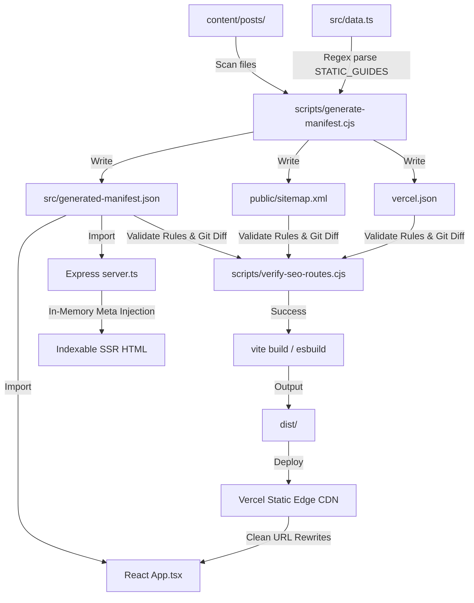

# SnakePlantSoil.com — SEO & Routing Architecture

This document details the automated SEO pipeline, edge routing, build-time manifest generation, and route verification checks implemented on [snakeplantsoil.com](https://snakeplantsoil.com/).

---

## 1. Pipeline Flow

The following diagram illustrates how the system compiles the content files and static database configuration into the routing and sitemap files, followed by SEO validation and client/server execution:



---

## 2. Core Components

### 1. Source Content (`content/posts/`)
- **Format**: Supports `.md` (with YAML frontmatter) and `.json` files.
- **Validation**: Each file must contain a `title`, a `slug`, and a `description` (or `excerpt`).
- **Filename Convention**: Filenames must match their slugs exactly (e.g. `winter-watering-guide.md` maps to `/winter-watering-guide`).

### 2. Manifest Generator (`scripts/generate-manifest.cjs`)
Executed at the start of `npm run build`. It compiles:
- **`src/generated-manifest.json`**: An in-memory route registry listing all static and dynamic slugs and their metadata.
- **`public/sitemap.xml`**: A sitemap containing canonical URLs.
- **`vercel.json`**: An edge routing configuration containing redirect rules and parameter-based rewrites mapping valid slugs to the root `/`.

### 3. SEO Verification Gatekeeper (`scripts/verify-seo-routes.cjs`)
Executed before Vite compilation during `npm run build` and CI deployment:
- Validates metadata presence and structure.
- Asserts that every sitemap URL is listed in the manifest and vice-versa.
- Validates sitemap URL formats (clean slugs, no www, no insecure HTTP, no file extensions, and no trailing slashes).
- Checks for duplicate slugs across static and dynamic content.
- **CI Stale Check**: Runs `git status --porcelain` in CI environments to fail the build if the committed `vercel.json`, `sitemap.xml`, or `generated-manifest.json` are stale compared to what is currently generated. In automated publishing workflows (such as `.github/workflows/podcast-sync.yml`), this check is bypassed via `ALLOW_UNCOMMITTED_SEO=true` so newly generated files can be verified and smoke-tested prior to being committed.

### 4. Edge Router (`vercel.json`)
- **Redirects**: Evaluates 1-hop redirects to the canonical domain and strips homepage variants (`/home`, `/index.html`) and legacy `/dynamic-*` paths.
- **Rewrites**: Maps valid slugs using a regex parameter (`/:slug(a|b|c)`) to serve `/` (resolving to `index.html`) with a `200 OK` status. Any unmatched path falls through, returns a genuine `404 Not Found` status, and renders `/404.html`.

### 5. Development Server (`server.ts`)
- Imports `generated-manifest.json` to configure the router.
- Emulates Vercel's edge routing locally: returns `200` for valid slugs and a real `404` for invalid paths.
- Performs on-the-fly HTML string replacement to inject `<title>`, `<meta name="description">`, `<link rel="canonical">`, and `<meta name="robots">` tags for indexable and error views.

### 6. Client Router (`src/App.tsx`)
- Maps the window pathname to the active tab view using the route manifest.
- Programmatically sets `document.title`, description meta tags, and appends/removes canonical link tags inside the DOM during transitions.

---

## 3. Operations & Safe Publishing Workflow

> **CRITICAL PRODUCTION SAFEGUARD:**  
> Never push directly to `main`. All article and podcast updates must be developed on a dedicated branch, validated locally via `npm run publish-check`, pushed to a remote branch, reviewed, and merged via Pull Request.

### Publishing a New Article or Guide
1. Create and switch to a dedicated content branch:
   ```bash
   git checkout -b content/publish-<slug>
   ```
2. Create or edit the markdown file in `content/posts/` (e.g., `content/posts/<slug>.md`).
3. Run the automated local gatekeeper check:
   ```bash
   npm run publish-check
   ```
   *(This regenerates the manifest, sitemap, vercel.json, verifies all SEO rules, and runs the production compiler).*
4. Stage the content file and regenerated artifacts, then commit and push to the feature branch:
   ```bash
   git add content/posts/<slug>.md src/generated-manifest.json public/sitemap.xml vercel.json
   git commit -m "feat(content): publish <slug>"
   git push origin content/publish-<slug>
   ```
5. Open a Pull Request into `main`. Verify CI build checks and review preview deployments before merging to production.

---

### Snake Plant Radio RSS Sync & Publishing System

Snake Plant Radio is syndicated via the official Anchor/Spotify RSS feed:
`https://anchor.fm/s/118565be4/podcast/rss`

#### Build-Time RSS Synchronization (`scripts/sync-episodes-rss.cjs`)
1. **Zero Runtime Dependency**: RSS sync runs entirely at build time during `npm run build` or manually via `npm run sync:podcast`. No network requests occur during visitor browsing or express request execution.
2. **Editorial Preservation**: Local Markdown files in `content/episodes/` retain 100% of their human-curated content (transcripts, companion guide cross-links, interactive tools, and editorial excerpts). The sync script only updates technical feed fields (`audioUrl`, `guid`, exact `duration`).
3. **Automatic Scaffold for New Releases**: When a new episode is published to Anchor/Spotify, the build script automatically scaffolds a new `content/episodes/<slug>.md` file with the official title, audio enclosure MP3, publication date, and formatted runtime.
4. **Offline & Build Resilience**: If the Anchor RSS endpoint is unreachable or times out (8s limit), the build falls back to existing local markdown files without interrupting the build or failing prerendering.
5. **Spotify Web Link Limitation**: Anchor RSS XML feeds provide direct audio enclosures (`.mp3`) and podcaster links, but do *not* contain consumer Spotify player URLs (`open.spotify.com/episode/...`). The web player gracefully falls back to a clean native `<audio>` stream when `audioUrl` is present, while Spotify player links can be added to frontmatter (`spotifyUrl` / `spotifyEmbedUrl`) for the embedded Spotify iframe.

#### How Future Episodes Appear & What Triggers a Vercel Build
Future podcast releases appear on SnakePlantSoil.com via two triggers:
- **Git Push (Standard Workflow)**: A publisher runs `npm run sync:podcast`, adds companion guide links or transcripts in `content/episodes/`, commits to a branch, and merges a Pull Request to `main`. Vercel automatically detects the push and initiates a new production build.
- **Vercel Deploy Hook (Automated Cron / Webhook)**: A Vercel Deploy Hook URL can be triggered by a weekly GitHub Action, Zapier, or RSS feed monitor when a new `<item>` is published. When triggered, Vercel executes `npm run build`, which runs `sync:podcast`, detects the new episode, updates `sitemap.xml` and `generated-manifest.json`, and prerenders `/radio/<slug>` into static HTML.

---

### Weekly Thursday Snake Plant Radio Episode Workflow
1. Check out a dedicated podcast branch:
   ```bash
   git checkout -b podcast/ep-<number>-<slug>
   ```
2. Sync the latest episode from the feed or create the file:
   ```bash
   npm run sync:podcast
   ```
3. Enrich the episode markdown file in `content/episodes/<slug>.md`:
   - Verify frontmatter (`title`, `slug`, `date`, `duration`, `category`).
   - Add the consumer `spotifyUrl` and `spotifyEmbedUrl` from Spotify.
   - Cross-link 2–3 relevant companion guides in `relatedGuides`.
   - Add detailed episode notes, takeaways, or full transcript.
4. Validate and regenerate the registry:
   ```bash
   npm run publish-check
   ```
5. Commit, push the branch, and open a Pull Request:
   ```bash
   git add content/episodes/ src/generated-manifest.json public/sitemap.xml vercel.json
   git commit -m "feat(podcast): release episode <number> - <slug>"
   git push origin podcast/ep-<number>-<slug>
   ```
6. Review the Vercel branch preview deployment. Once verified, merge the PR into `main` to trigger the production deploy.

---

### Deleting an Article or Episode
1. Check out a maintenance branch: `git checkout -b content/retire-<slug>`.
2. Delete or archive the file in `content/posts/` or `content/episodes/`.
3. If necessary, configure a 301 redirect in `scripts/generate-manifest.cjs`.
4. Run `npm run publish-check`.
5. Push the branch, open a PR, and merge after review.
