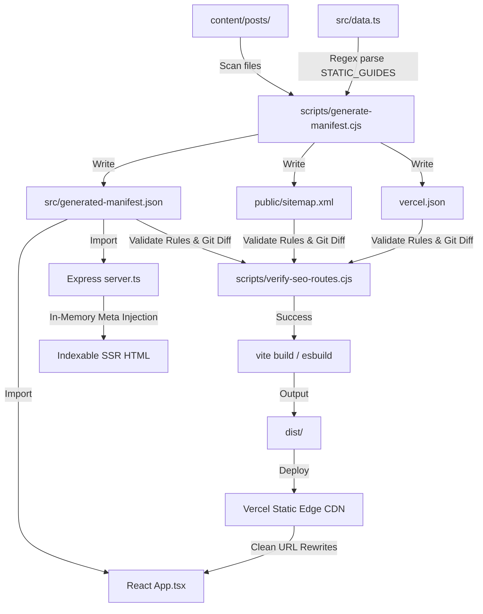

# SnakePlantSoil.com — SEO & Routing Architecture

This document details the automated SEO pipeline, edge routing, build-time manifest generation, and route verification checks implemented on [snakeplantsoil.com](https://snakeplantsoil.com/).

---

## 1. Pipeline Flow

The following diagram illustrates how the system compiles the content files and static database configuration into the routing and sitemap files, followed by SEO validation and client/server execution:



---

## 2. Core Components

### 1. Source Content (`content/posts/`)
- **Format**: Supports `.md` (with YAML frontmatter) and `.json` files.
- **Validation**: Each file must contain a `title`, a `slug`, and a `description` (or `excerpt`).
- **Filename Convention**: Filenames must match their slugs exactly (e.g. `winter-watering-guide.md` maps to `/winter-watering-guide`).

### 2. Manifest Generator (`scripts/generate-manifest.cjs`)
Executed at the start of `npm run build`. It compiles:
- **`src/generated-manifest.json`**: An in-memory route registry listing all static and dynamic slugs and their metadata.
- **`public/sitemap.xml`**: A sitemap containing canonical URLs.
- **`vercel.json`**: An edge routing configuration containing redirect rules and parameter-based rewrites mapping valid slugs to the root `/`.

### 3. SEO Verification Gatekeeper (`scripts/verify-seo-routes.cjs`)
Executed before Vite compilation during `npm run build` and CI deployment:
- Validates metadata presence and structure.
- Asserts that every sitemap URL is listed in the manifest and vice-versa.
- Validates sitemap URL formats (clean slugs, no www, no insecure HTTP, no file extensions, and no trailing slashes).
- Checks for duplicate slugs across static and dynamic content.
- **CI Stale Check**: Runs `git status --porcelain` in CI environments to fail the build if the committed `vercel.json` or `sitemap.xml` are stale compared to what is currently generated.

### 4. Edge Router (`vercel.json`)
- **Redirects**: Evaluates 1-hop redirects to the canonical domain and strips homepage variants (`/home`, `/index.html`) and legacy `/dynamic-*` paths.
- **Rewrites**: Maps valid slugs using a regex parameter (`/:slug(a|b|c)`) to serve `/` (resolving to `index.html`) with a `200 OK` status. Any unmatched path falls through, returns a genuine `404 Not Found` status, and renders `/404.html`.

### 5. Development Server (`server.ts`)
- Imports `generated-manifest.json` to configure the router.
- Emulates Vercel's edge routing locally: returns `200` for valid slugs and a real `404` for invalid paths.
- Performs on-the-fly HTML string replacement to inject `<title>`, `<meta name="description">`, `<link rel="canonical">`, and `<meta name="robots">` tags for indexable and error views.

### 6. Client Router (`src/App.tsx`)
- Maps the window pathname to the active tab view using the route manifest.
- Programmatically sets `document.title`, description meta tags, and appends/removes canonical link tags inside the DOM during transitions.

---

## 3. Operations & Publishing Workflow

### Publishing a New Article
1. Create a markdown or JSON file in `content/posts/` (e.g. `content/posts/my-new-guide.md`).
2. Run:
   ```bash
   npm run publish-check
   ```
   *(This regenerates the manifest, sitemap, vercel.json, verifies all SEO rules, and runs the production compiler).*
3. Commit and push the new article and the updated configurations:
   ```bash
   git add .
   git commit -m "Publish: my-new-guide"
   git push origin main
   ```

### Deleting an Article
1. Delete the article file inside `content/posts/`.
2. Run `npm run publish-check`.
3. Commit and push the deletions and the regenerated files.
